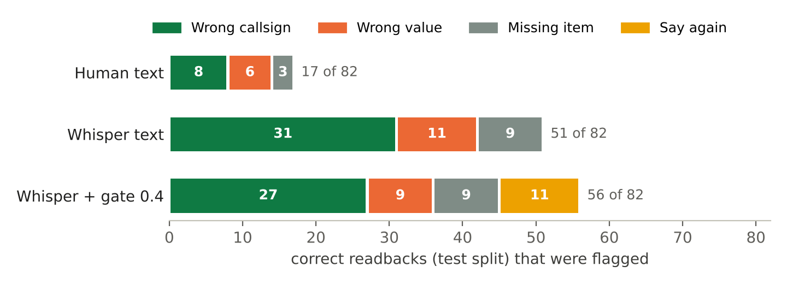
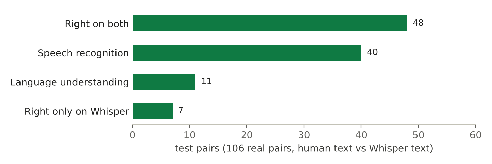
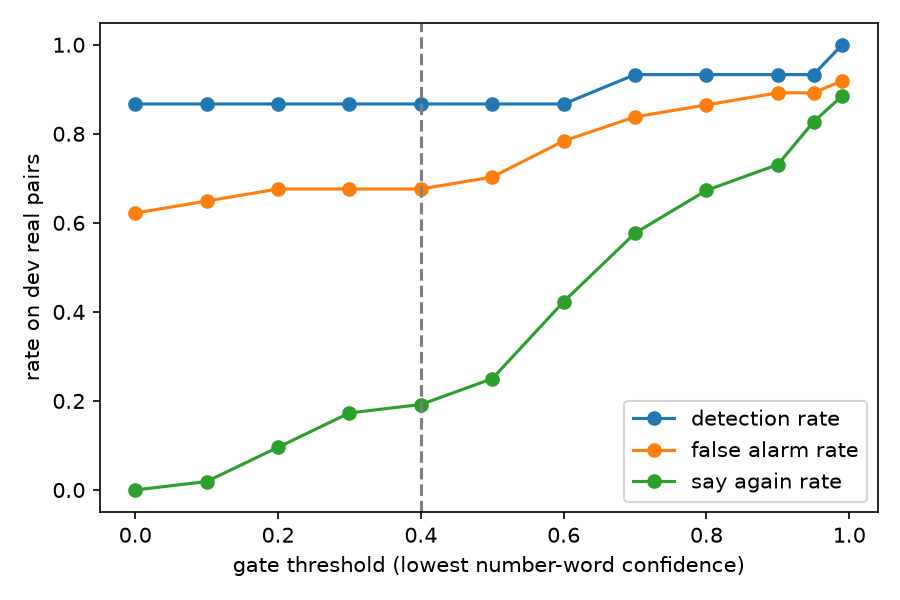

## Foreword

*I would like to thank the amazing people at atomcamp who through their sheer determination allowed me to reach a threshold that pushed me to the best of my abilities, through which I was able to complete this project, here is to conquering the world of knowledge with atomcamp.*

<p class="sign">Abdul Rahman</p>

## Abstract

A pilot reads back safety-critical parts of every air traffic control clearance so the controller can catch a mishearing. Readback Guard is an LLM-based agent that does the same check automatically: Whisper transcribes the controller and the pilot, Gemini 3.5 Flash-Lite extracts each clearance as JSON, Python rules compare the two sides, and a confidence gate answers "say again" when a number was heard too uncertainly. The research question is how many false alarms and missed errors come from speech recognition and how many from language understanding. On 106 real controller–pilot pairs from Prague (UWB-ATCC test split, scored once), the system caught 23 of 24 real errors on human transcripts and 24 of 24 on Whisper transcripts, but its false-alarm rate rose from 21% to 62% when Whisper replaced the human transcript. Forty pairs were judged correctly on human text and wrongly on Whisper text, against 7 the other way round (exact McNemar test, p < 0.0001): speech recognition, mainly of callsigns, is the dominant source of error. A gate on number confidence turned 6 of 51 false accusations into "say again". On 20 pairs recorded by the author, all 10 deliberate errors were caught. The system is useful as a second listener, but its false-alarm rate on real radio speech is far too high to replace the controller's own hearback.


## 1. Problem

A pilot must read back safety-critical parts of a clearance (level, heading, speed, frequency, squawk, runway) so the controller can catch a mishearing. Controllers miss wrong readbacks under workload ("hearback" errors). Readback Guard listens to a controller instruction and the pilot's reply and says whether the readback is correct, which item is wrong or missing, or asks "say again" when it cannot hear a number clearly.

**Research question:** when the system raises a false alarm or misses an error, how much of that comes from speech recognition, and how much from language understanding?

## 2. Data

- **UWB-ATCC** (Prague, CC BY-NC-SA 4.0, non-commercial; fine for coursework). Its test split (2,822 segments, 677 recordings) was merged into speaker turns (same speaker, gap ≤ 1.0 s) and paired controller turn → pilot turn: 774 candidate pairs, split by recording into dev (40%) and test (60%) so no conversation is in both.
- **Gold labels:** 158 pairs kept (52 dev, 106 test) with callsign, items and verdict for each side. *Drafted by Claude, verified by the author row by row*, then frozen in git (commit 5f23788) before any system was scored. Verdicts: 119 CORRECT, 30 MISSING_ITEM, 5 WRONG_CALLSIGN, 4 WRONG_VALUE.
- **Injected errors:** real wrong readbacks are rare, so each correct pair got one copy with the last spoken digit of a value or callsign changed (117 copies: dev 35, test 82). They exist only as text.
- **Own recordings:** 20 controller/pilot pairs voiced by the author from scripts drafted by Claude (`labels/own_recordings.csv`): 10 correct, 5 wrong value, 2 wrong callsign, 3 missing item. The only real speech containing real errors.

## 3. System

```
audio → Whisper (ATC large-v3, word confidences) → Gemini 3.5 Flash-Lite (clearance as JSON)
      → Python normalise + compare → confidence gate → verdict + reason
```

- **Speech:** `jlvdoorn/whisper-large-v3-atco2-asr`, greedy decoding on the Mac GPU; each word's confidence is the lowest token probability inside it.
- **Extraction:** Gemini returns `{callsign, items[type, value, unit, qualifier]}` validated by a Pydantic schema; answers are cached by model + prompt version + text. Prompt v1 was kept after a v2 attempt gave more false alarms on dev.
- **Rules:** values are normalised (e.g. `FL120`, `090`, `121.9`) and compared. Precedence: WRONG_CALLSIGN > WRONG_VALUE > MISSING_ITEM > CORRECT. A callsign matches if one is a shortened or cut-off form of the other. 58 unit tests.
- **Gate:** if any number word on either side was heard below a confidence threshold, the verdict becomes SAY_AGAIN. The threshold was chosen on dev and frozen before the test split. The rule written down first (highest detection minus false-alarm rate) counts a "say again" as a false alarm, so it can never reward the gate and picked 0.0 (gate off). After seeing the dev curve, the rule was changed to: fewest false accusations plus missed errors, with "say again" on at most 20% of pairs. This picked 0.4. The change was made on dev only; the test split was untouched.
- **Agent:** a 3-node LangGraph graph (extract → compare → gate) with retries on invalid JSON or server errors, wrapping the same functions as the experiment pipeline. The Streamlit demo runs it.

## 4. Experiments and results

Detection rate = errors flagged (anything but CORRECT) / real errors. False-alarm rate = correct readbacks flagged / correct readbacks. 95% Wilson intervals.


**Statistical methods.** Detection and false-alarm rates are proportions on small samples, so each carries a 95% Wilson score interval, which behaves well near 0 and 1 where the normal approximation fails. Human text and Whisper text are compared on the *same* pairs, so the comparison is paired: McNemar's test uses only the discordant pairs (right on one text, wrong on the other); under the null hypothesis that the text source makes no difference, each discordant pair is a fair coin, so the exact test is a two-sided binomial test of b against b + c with p = 0.5. Thresholds and prompts were tuned on dev only; the test split and the own recordings were scored once, in one notebook run (`notebooks/05_final_scoring.ipynb`, commit 037a1f9), and every result row is logged with its git commit in `results/log.csv`.

**Critical values by field (test split).** Share of values whose spoken digits Whisper did not reproduce exactly:

| Side | Field | Values | Error rate |
|---|---|---|---|
| Controller | callsign digits | 100 | 0.10 |
| Controller | runway | 79 | 0.00 |
| Controller | frequency | 18 | 0.39 |
| Controller | squawk / speed | 8 | 0.13 |
| Pilot | callsign digits | 81 | 0.31 |
| Pilot | runway | 65 | 0.14 |
| Pilot | frequency | 12 | 0.58 |
| Pilot | squawk | 3 | 0.00 |

Pilot transmissions are noisier and shorter, and pilot callsigns are the worst field: almost a third of their digits come out wrong, before the airline word is even considered.

**Experiment 1 (dev, human transcripts, 87 cases):** with gold fields fed straight to the rules, 50/50 errors detected, 0/37 false alarms (the rules are sound; 86/87 exact verdicts, the one difference is a label conflict, see limits). With Gemini extraction: 47/50 detected (0.94, CI 0.84–0.98), 2/37 false alarms (0.054, CI 0.015–0.18). Almost every mistake was Gemini on the pilot side: completing cut-off numbers, inventing a runway, merging words into a callsign.

**Speech recognition quality:** WER after the same normalisation on both sides: dev 27.2% (controller 17.9%, pilot 43.5%); test 25.0% (controller 17.4%, pilot 38.5%). Critical-value error rate (values spoken digit by digit that Whisper did not reproduce exactly): dev 14.7% of 177; test 16.1% of 366. Pilot callsigns are the weakest field.

**Main table (test split, scored once):**

| Text source | Detection | False alarms (any flag) | False accusations | Say again | Exact verdict |
|---|---|---|---|---|---|
| Human text, real + injected (Exp 1b), 188 cases | 100/106 = 0.94 (0.88–0.97) | 17/82 = 0.21 (0.13–0.31) | 17 | – | 0.81 |
| Human text, real pairs, 106 | 23/24 = 0.96 (0.80–0.99) | 17/82 = 0.21 (0.13–0.31) | 17 | – | 0.77 |
| Whisper text, real pairs (Exp 2), 106 | 24/24 = 1.00 (0.86–1.00) | 51/82 = 0.62 (0.51–0.72) | 51 | – | 0.42 |
| Whisper + gate 0.4, real pairs (Exp 3), 106 | 24/24 = 1.00 (0.86–1.00) | 56/82 = 0.68 (0.58–0.77) | 45 | 19 (0.18) | 0.34 |

"False accusations" are correct readbacks given an error verdict (WRONG_VALUE, WRONG_CALLSIGN or MISSING_ITEM); "say again" is counted separately. Perfect detection on Whisper text is not good news on its own: the system flags so much that real errors are caught partly by accident, which the exact-verdict rate (0.42 vs 0.77) shows.



**Attribution (test, real pairs).** For each pair: right on both texts; wrong only on Whisper text (caused by speech recognition); wrong on both (caused by language understanding, since the rules are near-perfect on gold fields); wrong only on human text.

| Gold label | Right on both | Speech recognition | Language understanding | Right only on Whisper | Total |
|---|---|---|---|---|---|
| Correct readback (wrong = false alarm) | 25 | 40 | 11 | 6 | 82 |
| Real error (wrong = miss) | 23 | 0 | 0 | 1 | 24 |
| Total | 48 | 40 | 11 | 7 | 106 |



McNemar's exact test on the discordant pairs (40 right only on human text, 7 right only on Whisper text): p < 0.0001. With the gate the counts are 43 and 5 (p < 0.0001); the gate does not change who causes the mistakes, it changes what the system says about them.

On human text, the 17 false alarms are language understanding (Gemini) and labels: an extracted runway with an extra "C" (3 cases), a different runway number on the pilot side (3), a missing item (3), and 8 callsign mismatches, including callsign forms the rule cannot match such as the known telephony vs ICAO case ("russia 221" vs "sdm 221", 2 cases). Which of these are Gemini errors and which are label problems was not checked case by case. On Whisper text, 31 of the 51 false alarms are WRONG_CALLSIGN, mostly from misheard airline words or callsign digits (inferred from the reasons, not counted one by one).



**Gate trade-off (dev):** On Whisper text, false alarms rose from 2/37 (human text) to 23/37, mostly wrong-callsign verdicts. Raising the threshold turns false accusations into "say again": 23 at threshold 0 (gate off), 16 at 0.4 with 10 of 52 pairs answered "say again", 2 at 0.95 with 43 of 52 answered "say again". Missed errors stay at 2 of 15 until 0.7.

**Own recordings (20 pairs, real speech, real errors):** on script text, 10/10 errors detected with the right verdict and 0/10 false alarms. On Whisper text, still 10/10 detected but 4/10 false alarms, all WRONG_CALLSIGN from misheard airline names on the controller side ("Liner" for Ryanair, "Visor"/"Vizor" for Wizz Air, "str" for Austrian, "smart wing" for Smartwings). Two real WRONG_VALUE errors (r02, r10) were reported as WRONG_CALLSIGN for the same reason. The gate never fired: all numbers in these clean recordings were heard with confidence above 0.4. McNemar: 4 vs 0 discordant, p = 0.125 (too few pairs to be significant).

## 5. Discussion

Most errors produced by the system are false alarms, with speech recognition being the primary source of these mistakes. In the test split, 40 readbacks that were correctly identified using human-transcribed text were incorrectly flagged when Whisper-generated text was used, compared with 11 cases where both sources failed due to language-understanding errors and 7 cases where the opposite occurred (McNemar's test, *p* < 0.0001). Missed errors were uncommon in both cases, with only 1 out of 24 occurring on human-transcribed text and none on Whisper text. These results suggest that the main concern is an overly sensitive checker that raises incorrect warnings rather than one that fails to detect genuine errors. Callsign recognition appears to be the main weakness: Whisper struggles considerably more with airline names and pilot callsigns than with numerical information. Although the critical-value error rate is 16%, 31 of the 51 false alarms are attributed to `WRONG_CALLSIGN`. The existing confidence gate, which evaluates only numerical values, converted 6 of the 51 false accusations into "say again" responses, while generating 19 such responses across 106 pairs. While this provides some improvement, a more effective solution would involve a confidence mechanism that also accounts for callsign recognition or an ASR model trained to recognize the airline names and callsign vocabulary specific to the airport.

## 6. Verdict: why human controllers are still kept

The question behind this project is whether a machine could do the controller's hearback. The results say it can help, but it cannot replace the human, for five reasons that come straight from the numbers above.

1. **It cries wolf.** On real radio speech, 51 of 82 correct readbacks (62%) were flagged. A controller who receives a false warning on more than half of all readbacks will learn to ignore the warnings, which is alarm fatigue, the failure mode that makes alerting systems dangerous. A human controller hears the same transmission in context and does not raise an alarm because one word was mumbled.
2. **Its weak point is exactly the human's strength.** Most false alarms are wrong callsigns: Whisper turned "Ryanair" into "Liner" and "Wizz Air" into "Visor". A controller knows which aircraft are on the frequency, so an unclear callsign is resolved by context; the system has no picture of the traffic.
3. **Detection is good but not proven.** The system missed 1 of 24 real errors on human text and 0 on Whisper text, and caught all 10 errors in the author's recordings. But only 24 real errors exist in the test split, 22 of them missing items and none a wrong value, so the 95% interval for detection on Whisper text still reaches down to 0.86. Aviation needs far stronger evidence than that before a tool is trusted.
4. **Uncertainty is handled crudely.** The gate can only ask "say again" when a number sounds uncertain. It cannot notice a word that was never transcribed, it does not look at callsigns, and it asked for a repeat in 18% of pairs while removing only 6 false accusations. A controller decides when to ask for a repeat with far more judgement.
5. **Responsibility.** A wrong clearance that goes unnoticed can cause a level bust or a runway incursion. Someone has to be accountable for accepting a readback; a system with a measured false-alarm rate of 62% and a language model that occasionally invents a runway suffix cannot carry that responsibility.

**Where it does fit.** As a second listener the system is promising: on clean speech it was nearly perfect (0 false alarms and 10/10 errors on script text), and on human transcripts it caught 23 of 24 real errors. It could highlight possible readback errors for the controller to confirm, or be used after the fact to review recordings for training and safety reports. Before even that, it needs a speech model that knows the airport's callsigns and airline names, a gate that also covers callsigns, and a much larger set of real readback errors to measure detection properly.

## 7. Limits

- Small samples: 24 real errors in the test split (22 of them missing items, 2 wrong callsigns, 0 wrong values), hence wide intervals. The test split's false-alarm rate on human text (0.21) is much higher than on dev (0.05), so dev-based choices (prompt v1, gate threshold) may not transfer perfectly. Injected errors are text-only, so they cannot test the audio path; the own recordings (20 pairs, one speaker, quiet room) are the only real speech with real errors.
- p0736 is labelled WRONG_VALUE, but the pilot also mangled the callsign, so the precedence rule gives WRONG_CALLSIGN. Labels stayed frozen.
- While debugging the error injector in Module 2, the rules were run once on the gold fields of the test split. It exposed an injector bug (fixed) and that some test labels write one callsign in two forms ("russia 221" vs "sdm 221"). No rule or prompt was changed because of it.
- The gate cannot catch words Whisper dropped (a deletion has no confidence) and only watches number words, not callsign words, which is where most Whisper false alarms come from.
- The gate threshold rule was changed after seeing the dev curve (still before the test split was scored).
- The own recordings were voiced by one speaker in a quiet room and are much cleaner than real radio; both sides were read by the author.
- Free-tier Gemini limits and model names change; the cache and a single wrapper file keep results reproducible.

## 8. Deviations from the Blueprint

One ASR model instead of two; 158 gold pairs; runway scored (6 types); Gemini 3.5 Flash-Lite instead of 3.8 Flash (time-outs with JSON output); about 20 own recordings instead of 150; regex baseline dropped; NOT_A_READBACK filtered at labelling; SAY_AGAIN overrides other verdicts when a number is uncertain (Blueprint precedence put it below the error verdicts); the gate threshold rule was changed on dev after the first rule picked 0.0.

## 9. Who did what

The author designed the project, verified every gold label, wrote the normalisation and comparison logic, recorded the own set and ran every experiment. Claude (an AI assistant) drafted the gold labels and own-recording scripts, wrote the confidence gate (gate.py) at the author's request, wrote boilerplate code (data loading, caching, batch scripts, scoring notebooks, the Streamlit layout) and drafted most of this report, including the abstract and the verdict in section 6; the discussion in section 5 was written by the author.


## 10. Reproducing the results

Code: <https://github.com/TechnoBear212/read-back-guard>. Python 3.12 (conda env `readback`), packages pinned in `requirements.txt`; a Gemini API key in `.env`. The pipeline runs in this order: `python -m readback_guard.transcribe` (Whisper on the gold pairs), `python -m readback_guard.batch dev|test|own` (Gemini extraction, cached), `notebooks/02_text_checker.ipynb` (Experiment 1), `notebooks/04_audio_path_dev.ipynb` (Experiment 2 and the gate on dev), `notebooks/05_final_scoring.ipynb` (test split and own recordings, once). The demo is `streamlit run app/streamlit_app.py`. Tests: `pytest -q` (58 tests).

## References

- Šmídl, L., Švec, J., Tihelka, D., Matoušek, J., Romportl, J., Ircing, P. (2019). Air traffic control communication (ATCC) speech corpora and their use for ASR and TTS development. *Language Resources and Evaluation*. Dataset used here: UWB-ATCC via Hugging Face `Jzuluaga/uwb_atcc` (CC BY-NC-SA 4.0).
- Whisper ATC model: `jlvdoorn/whisper-large-v3-atco2-asr` on Hugging Face, fine-tuned from OpenAI Whisper large-v3 (Radford et al., 2023, *Robust Speech Recognition via Large-Scale Weak Supervision*).
- ICAO Annex 11, Air Traffic Services, 3.7.3 (items that must be read back), via SKYbrary.
- McNemar, Q. (1947). Note on the sampling error of the difference between correlated proportions or percentages. *Psychometrika* 12, 153–157.
- Wilson, E. B. (1927). Probable inference, the law of succession, and statistical inference. *JASA* 22, 209–212.

## Appendix: own recordings, verdict per pair

| Pair | Gold | Script text | Whisper text | Whisper + gate | Reason (Whisper + gate) |
|---|---|---|---|---|---|
| r01 | CORRECT | CORRECT | CORRECT | CORRECT | all items read back |
| r02 | WRONG_VALUE | WRONG_VALUE | WRONG_CALLSIGN | WRONG_CALLSIGN | callsign "sunza 452" read back as "lufthansa 452" |
| r03 | CORRECT | CORRECT | WRONG_CALLSIGN | WRONG_CALLSIGN | callsign "liner 3ab" read back as "ryanair 3ab" |
| r04 | MISSING_ITEM | MISSING_ITEM | MISSING_ITEM | MISSING_ITEM | frequency 127.125 not read back |
| r05 | CORRECT | CORRECT | CORRECT | CORRECT | all items read back |
| r06 | WRONG_CALLSIGN | WRONG_CALLSIGN | WRONG_CALLSIGN | WRONG_CALLSIGN | callsign "visor 530" read back as "vizir 538" |
| r07 | CORRECT | CORRECT | WRONG_CALLSIGN | WRONG_CALLSIGN | callsign "str6ma" read back as "austrian 6ma" |
| r08 | WRONG_VALUE | WRONG_VALUE | WRONG_VALUE | WRONG_VALUE | squawk 2351 read back as 2357 |
| r09 | CORRECT | CORRECT | CORRECT | CORRECT | all items read back |
| r10 | WRONG_VALUE | WRONG_VALUE | WRONG_CALLSIGN | WRONG_CALLSIGN | callsign "liner 82k" read back as "ryanair 82k" |
| r11 | MISSING_ITEM | MISSING_ITEM | MISSING_ITEM | MISSING_ITEM | speed 220 not read back |
| r12 | CORRECT | CORRECT | WRONG_CALLSIGN | WRONG_CALLSIGN | callsign "smart wings 456" read back as "smart wing 456" |
| r13 | WRONG_CALLSIGN | WRONG_CALLSIGN | WRONG_CALLSIGN | WRONG_CALLSIGN | callsign "38w" read back as "csa 883w" |
| r14 | CORRECT | CORRECT | WRONG_CALLSIGN | WRONG_CALLSIGN | callsign "visor 21l" read back as "vizor 21l" |
| r15 | WRONG_VALUE | WRONG_VALUE | WRONG_VALUE | WRONG_VALUE | frequency 121.9 read back as 121.8 |
| r16 | MISSING_ITEM | MISSING_ITEM | MISSING_ITEM | MISSING_ITEM | runway 06 not read back |
| r17 | CORRECT | CORRECT | CORRECT | CORRECT | all items read back |
| r18 | WRONG_VALUE | WRONG_VALUE | WRONG_VALUE | WRONG_VALUE | level FL120 read back as FL150 |
| r19 | CORRECT | CORRECT | CORRECT | CORRECT | all items read back |
| r20 | CORRECT | CORRECT | CORRECT | CORRECT | all items read back |
